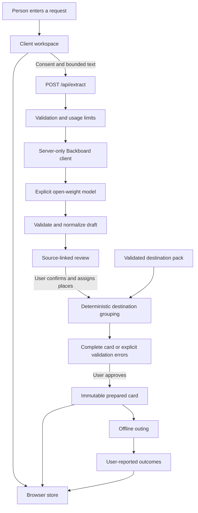
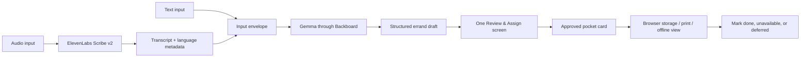

# Nikal — Architecture and Product Contracts

**Status:** Target architecture with an early manual prototype; checkpoint updated on 10 October 2026.  
**Product:** Nikal, the reviewed family-errand handoff selected as the final direction. ChaloList is the earlier broader concept.  
**Repository directory and current package name:** `walkrecall`. The name is a setup artifact, not a requirement to build the previously considered study app.  
**Document scope:** Product boundaries, modules, contracts, state, inference, planning, persistence, offline behavior, security, deployment, and verification. This document does not claim those features are implemented.

> Turn a messy family request into one reviewed, destination-assigned, mobile errand card without quietly losing cancellations, unclear instructions, or unfinished tasks.

## Contents

1. [Current repository and implementation status](#1-current-repository-and-implementation-status)
2. [Product outcome and scope](#2-product-outcome-and-scope)
3. [Architectural decisions](#3-architectural-decisions)
4. [System boundaries and data flow](#4-system-boundaries-and-data-flow)
5. [Domain vocabulary and invariants](#5-domain-vocabulary-and-invariants)
6. [Data model](#6-data-model)
7. [State transitions and concurrency](#7-state-transitions-and-concurrency)
8. [AI extraction pipeline](#8-ai-extraction-pipeline)
9. [Archived walking-planner design — not in Nikal v1](#9-archived-walking-planner-design--not-in-nikal-v1)
10. [API contract and error handling](#10-api-contract-and-error-handling)
    - [Final input and review flow](#105-final-nikal-input-and-review-flow)
    - [Mobile card design](#106-final-mobile-card-design)
11. [Frontend and accessibility](#11-frontend-and-accessibility)
12. [Local persistence and offline behavior](#12-local-persistence-and-offline-behavior)

**Scope:** Nikal v1 is a reviewed errand handoff, not a walking-route planner. Sections 6.4–6.5 and 9 retain the earlier routing design for context only; their graph, timing, and feasibility requirements are not v1 gates. Sections 10.5–10.6 define the text/audio → extraction → review/assign → card target. Configuration, deployment, partner evidence, and release checks are in [`IMPLEMENTATION.md`](./IMPLEMENTATION.md).

## 1. Current repository and implementation status

### 1.1 Verified baseline

| Area | Observed state |
|---|---|
| Framework | `next` **16.4.0**, `react` / `react-dom` **19.3.0**, App Router |
| Language | TypeScript, strict mode, `@/*` resolves to the repository root |
| Package workflow | `package-lock.json` present; use npm consistently |
| Scripts | `npm run dev`, `npm run build`, `npm run start`, `npm run lint`, `npm test` |
| Styling | Tailwind CSS 4 with `@tailwindcss/turbopack`; tokens in `app/globals.css` |
| shadcn setup | `base-sera`, Base UI primitives, `olive` configuration, RSC and TSX enabled |
| Icons | Hugeicons; do not introduce a second icon family by habit |
| UI source | `components/ui/button.tsx` is the only installed UI component observed |
| Class utility | `lib/utils.ts` re-exports `cn` from the existing `cn` package |
| Fonts | Layout configures Manrope, Noto Sans, Geist, and Geist Mono |
| Next config | `cacheComponents: true`, `partialPrefetching: true`, Tailwind Turbopack rule |
| Landing page | Nikal manual text-to-card slice; local-only state, no provider call |
| Product backend | No product route handlers or AI integration yet |
| Product persistence | Versioned localStorage with Zod validation; no database, authentication, or offline worker |
| Tests | Node test runner through the existing TypeScript compiler; `tests/domain.test.ts` |

Dependency ranges above are not a claim about every installed transitive version. The lockfile is the installation source of truth.

### 1.2 Status discipline

Everything below is a **target design** unless explicitly marked observed. The current manual page, bounded browser persistence, and `lib/domain` contracts are an early slice. The manual UI uses a compact `ManualWorkspaceSchema`; full extracted/reviewed-errand integration, structured quantity/kind editing, clarification, provider calls, audio, print/export, and offline packaging remain. Sample requests and destinations are synthetic, not checked real-world places. Performance limits are initial policy choices, not measured performance claims.

The architecture write must not reset the user's existing changes to `app/globals.css`, `app/layout.tsx`, `package.json`, `package-lock.json`, `components.json`, `components/`, or `lib/`. No application renaming, dependency installation, deployment, or commit is implied by this document.

`AGENTS.md` requires reading the relevant installed guides in `node_modules/next/dist/docs/` before implementation. For this installed version, those guides take precedence over older remembered Next.js patterns. Do not remove the user's cache/prefetch configuration just to match an older example.

## 2. Product outcome and scope

### 2.1 The user journey

1. The person enters a short household request list in English, Hindi, or Hinglish.
2. AI proposes errands and identifies corrections, cancellations, and missing details.
3. The person reviews the source beside the proposed list and confirms what is intended.
4. The person assigns selected errands to familiar destinations from the selected pack; v1 samples are synthetic until a real pack is verified.
5. Ordinary code groups every included errand by its confirmed destination. It does not invent a route, travel time, or feasibility guarantee.
6. The person prepares a compact offline card, leaves the screen, and does the errands.
7. Completion is recorded honestly: done, unavailable, deferred, or still unfinished.

Illustrative input, not a real-user claim:

> “Doodh 1 litre, bread mat lana, parcel drop karna, aur stationery se notebook lena. I have 25 minutes.”

Expected interpretation includes the milk quantity, the bread cancellation, parcel drop-off, notebook purchase, and a time-budget suggestion requiring confirmation. It does not invent the shop, stock, price, parcel service, or today's opening hours.

### 2.2 First-release scope

- One person and one browser profile; no shared household accounts.
- One selected destination pack with at most five errand stops; no route graph required.
- Text input, short recorded audio transcription, and a manual-list fallback. Input-language quality must be evaluated separately.
- One open-model extraction pipeline; no autonomous purchasing or messaging.
- User-reviewed drafts, explicit deferral, and visible source text.
- Destination-grouped tasks; no route optimization or time-budget guarantee.
- Locally saved plan, pocket view, completion tracking, and print/export.
- A no-signup sample experience with clearly labelled synthetic examples, plus live inference when configured and permitted.

### 2.3 Explicit non-goals

No automatic WhatsApp access, contacts import, payments, price comparison, live inventory, nationwide shop search, GPS tracking, turn-by-turn navigation, accessibility certification, medical recommendations, calorie/carbon-savings claims, forecasting, model fine-tuning, vector database, durable workflow engine, or always-on agent. No route shortcuts through unverified alleys or private land.

Short browser recording and ElevenLabs transcription are planned input features after the text slice. Narration is not required. Scribe v2 is provisional until account support and the exact model ID are verified.

### 2.4 Success and failure

Success is a useful outing with fewer avoidable omissions and acceptably low planning effort. It is not time spent inside the app, a streak, or a count of sponsor integrations.

The product hypothesis fails if an ordinary checklist is consistently easier, if users do not have suitable walking errands, or if preparing neighbourhood data costs more than the workflow saves. Measure those limits rather than hiding them.

## 3. Architectural decisions

| Decision | Chosen boundary | Why / reconsider when |
|---|---|---|
| Application shape | One Next.js application, not microservices | UI plus extraction and transcription endpoints |
| Model responsibility | Draft interpretation only | AI does not own route arithmetic, task approval, or completion |
| Card preparation | Pure local TypeScript domain functions | Group all approved tasks without route claims |
| Persistence | Browser-owned, no application database in v1 | No accounts or cross-device sync requirement |
| Model serving | Hosted open-weight inference, provisionally Backboard | Practical first release; explicitly disclose data transmission |
| Model selection | Server configuration, not an arbitrary browser-supplied model | Predictable cost, capability and evaluation |
| Offline promise | Online preparation, offline reviewed outing | Do not mislabel remote inference as fully offline AI |
| Place knowledge | Small checked neighbourhood pack | Avoid making up real-world facts or relying on incomplete discovery |
| UI structure | Task workflow, not chatbot/dashboard | The screen should be a short preparation step |
| Approval | Explicit user review | Valid JSON and matching quotes do not prove intent was understood |
| Complexity ceiling | No state-management framework or orchestration framework initially | Add only after a concrete limit appears |

These are implementation defaults from the current brief. Decisions involving real place data, hardware, provider availability, budgets, and language accuracy remain unverified until tested.

## 4. System boundaries and data flow



### 4.1 Browser owns

Raw source text, draft edits, selected pack, place assignments, planning constraints, approved cards, outcomes, export, and deletion. Browser data is not an authoritative shared database and is not encrypted merely because it is local.

### 4.2 Application server owns

Input limits, provider credentials, explicit model configuration, prompt construction, model-output validation, usage limits, request deadlines, and redacted operational diagnostics. It does not store user lists as an application feature.

### 4.3 External provider receives

Only the text approved for extraction and the minimum prompt context. Do not send the person's home coordinates, complete history, outcomes, contact list, or verified neighbourhood graph. The first extraction need not know real place IDs; explicit destination wording can remain a string for local assignment.

Backboard and its inference provider may retain request/thread data according to their policies. Disabling memory is not equivalent to no retention. A local application with hosted inference is not an entirely private/offline system.

### 4.4 Dependency direction

- UI depends on domain contracts and browser persistence.
- The HTTP handler depends on contracts and the server-only extraction module.
- Domain logic imports neither React, Next.js, browser APIs, nor a provider SDK.
- Server-only modules must not be imported into client components, shared domain modules, or generated browser fixtures.
- Neighbourhood data and exported cards are validated at their own input boundaries.
- Runtime schemas and TypeScript types share one source of truth; do not maintain divergent copies.

## 5. Domain vocabulary and invariants

### 5.1 Vocabulary

| Term | Meaning |
|---|---|
| Source | One immutable revision of the person's original text |
| Draft | An unapproved interpretation of a specific source revision |
| Errand | A user-reviewable task, such as buying an item, collecting something, or dropping something off |
| Evidence | Exact text from the source supporting a proposed interpretation; not proof that the interpretation is correct |
| Review disposition | Whether an errand is included, cancelled, deferred, or unresolved |
| Place | A known local destination; its category does not prove stock or service availability |
| Walking connection | A checked, directed path between two points with estimated duration and provenance |
| Neighbourhood pack | Versioned places and connections, checked for internal consistency |
| Proposal | A computed, unapproved ordering of all selected stops |
| Prepared card | An approved snapshot of destination-grouped tasks, exclusions, and source revisions; estimates are absent without validated data |
| Outing | An attempt to use one prepared card outside |
| Outcome | A person's report of what happened to a planned task |
| Revision | A monotonic integer identifying a local workspace edit |

### 5.2 Non-negotiable invariants

1. **AI never approves a task, starts an outing, or marks an errand complete.**
2. **An empty extraction is not proof that the source contains no errands.** Preserve it for manual review.
3. Every displayed model-derived task cites valid source evidence. Manual additions are explicitly marked manual and do not need fabricated model evidence.
4. Every draft errand receives a user-confirmed disposition before preparation. Unresolved work must be resolved or explicitly deferred; it never disappears.
5. The user reviews the whole source for missing tasks. Quote checks cannot detect every omitted source request.
6. Only included, confirmed errands with assigned known places enter the card.
7. Card preparation includes every selected errand or returns a validation error. It does not silently select a convenient subset.
8. No invented routes, walking connections, or travel times. The archived routing design is not a v1 requirement.
9. An estimate is nullable and omitted from the UI when no validated timing data exists.
10. Any edit to the source, reviewed errands, place assignment, constraints, or pack version invalidates an unstarted proposal/card for starting purposes.
11. A started outing uses a frozen snapshot. New drafts do not rewrite its history.
12. Completion and cancellation are different. An item unavailable at a shop remains unfinished, not successful.
13. Provider failure, timeout, offline state, and manual mode must be distinguishable in the interface.
14. Local save failure must be visible. Do not claim “saved” or “ready offline” until the relevant operations succeed.

## 6. Data model

Use bounded JSON-compatible records. The following are design contracts, not files already implemented. IDs are application-generated UUIDs; model output cannot choose trusted record IDs. Timestamps are ISO strings; revisions are nonnegative integers.

### 6.1 Workspace and source

| Record | Required fields and rules |
|---|---|
| `Workspace` | `schemaVersion`, `id`, `revision`, `updatedAt`, `currentSource`, optional current draft/review/proposal/card, outing history; one browser-local aggregate |
| `SourceRevision` | `id`, `revision`, `text`, `createdAt`; preserve exactly the text submitted for extraction |
| `ExtractionRun` | App `requestId`, source ID/revision, state, provider/model label, prompt version, duration, bounded warnings; no credentials or raw provider response |
| `ReviewRecord` | Source/draft revision, `sourceCheckedForOmissions`, reviewed errands, confirmed time budget, `confirmedAt` |

Editing source text creates a new source revision and requires fresh review. Do not mutate old source text beneath an already-started outing. A simple one-document store is sufficient; this is not an event-sourcing requirement.

### 6.2 Evidence and draft errands

| Field | Contract |
|---|---|
| `kind` | `buy`, `collect`, `drop_off`, or `other`; unknown intent remains unresolved |
| `label` | Short plain text, never trusted HTML |
| `quantity` | Nullable `{ value: number, unit: string }`; finite positive value when present; fractional units allowed; no invented default quantity |
| `destinationText` | Nullable wording explicitly present in the source, not an invented shop |
| `suggestedDisposition` | `include`, `cancel`, or `clarify`; only a suggestion |
| `evidence` | One or more exact source quotes; the app locates occurrences and computes offsets |
| `questions` | Bounded clarification questions; no medical, purchasing, or navigation actions |
| `warnings` | Structured warning codes with short display explanations |
| `origin` | `model` or `manual` after conversion to an application record |

Evidence implementation:

- Ask the model for exact quotes, not character offsets.
- Locate each quote in the exact source on the server. Store `start` inclusive and `end` exclusive as JavaScript UTF-16 code-unit offsets.
- Require `source.text.slice(start, end) === quote`; do not lowercase or normalize one side of this check.
- Multiple quote occurrences remain explicitly ambiguous unless resolved by additional evidence or user review. Do not silently highlight the first occurrence as certain.
- Check bounds and nonempty quotes. Reject unsupported evidence rather than weakening the validator to accept it.
- Exact quote validity is a structural check. Correct negation, association, and intent still require evaluation and human review.

An English paraphrase can label a Hindi request, but its evidence must quote the actual Hindi/Hinglish source. Do not represent a translation as a direct quote.

### 6.3 Reviewed errands

Each reviewed errand contains:

- App ID, label, kind, optional quantity, origin and evidence.
- `disposition`: `included | cancelled | deferred | unresolved`.
- `placeId`: nullable until assigned; required if included in a plan.
- `reviewed`: whether the person confirmed this entry after its latest edit.
- `dispositionReason`: required for deferral; cancellation can reference the source or a manual correction.
- Optional manual clarification text. No model confidence percentage is presented as calibrated truth.

Do not merge similar labels automatically. “Two packets for home” and “one packet for the neighbour” may be separate tasks. A suggested duplicate needs user confirmation. A correction inside the same source can be proposed as one corrected task with evidence for both clauses; conflicting sources require clarification.

### 6.4 Neighbourhood pack — archived routing extension

Nikal v1 needs destinations and aliases only. The following start-point and connection design is retained for context, not an implementation requirement.

```text
NeighbourhoodPack
  schemaVersion, id, version, label, timezone
  provenance: source, checkedAt, coverageNotes, licenseOrPermission
  startPoint: id, publicLabel
  places[]:
    id, label, category, visitMinutesEstimate
    checkedAt, sourceNote, limitations
  connections[]:
    fromId, toId, minutesEstimate
    checkedAt, sourceNote, pathDescription
    viaPointIds[]
```

Rules:

- Up to five places plus the public start point in v1; IDs are unique within the pack.
- Connections are directed. A reverse connection is not assumed.
- A connection represents an entire checked leg, including its intermediate path if relevant. The planner does not synthesize missing legs.
- Duration estimates are positive finite integer minutes for distinct nodes. Stop-service estimates may be zero or positive, and are shown separately.
- Coordinates are optional and unnecessary for the first planner. No map display or routing API is implied by this model.
- All referenced IDs must exist. Reject duplicate directed edges, malformed values, invalid timestamps, and unsupported schema versions.
- `checkedAt` records provenance, not a guarantee of current conditions. Display check age and limitations; a user can mark a stop/leg unavailable for the current proposal.
- Stock and opening status are unknown unless freshly confirmed by the user. They are not inferred from category or old pack data.
- Public packs contain public place facts only. Home addresses, private household routines, and personal notes stay out of committed pack files.

### 6.5 Planning input, proposal, and prepared card — archived routing extension

Do not implement `PlanningConstraints` or `PlanProposal` for v1. Its card needs grouped errands, cancelled/deferred summaries, source revision, and destination provenance; route/timing fields are not required.

`PlanningConstraints`: explicit integer `availableMinutes` (5–120 initially), integer `bufferMinutes` (default 5; user-visible), selected pack/version, public start/return ID, and excluded place/connection IDs. Extraction may suggest a budget; the user confirms the form value. Conflict between text and form requires review.

`PlanProposal`: input workspace/review revision, pack version, result `feasible | infeasible`, ordered place IDs, errand IDs per stop, checked legs, estimated walking/stop/buffer/total minutes, visible warnings, and a structured failure reason if infeasible.

`PreparedCard`: app ID, creation time, schema version, input revision, frozen reviewed tasks, cancelled/deferred summary, place names, checked path descriptions, timing breakdown, pack provenance, and limitations. The frozen content is not changed by later pack updates.

Store outcomes separately from the frozen card. Do not retain full raw household text in a downloaded card by default; include only reviewed content needed outside and disclose that exports can still contain personal information.

### 6.6 Outing and outcomes

`Outing`: ID, prepared-card ID, `active | finished | abandoned`, self-reported start/end times, and task outcomes.

`TaskOutcome`: `done | unavailable | deferred | unresolved`, optional note, and last update time. The manual prototype uses `pending` for an unmarked outcome. An unavailable item can later become done through an explicit correction. No GPS or timer is treated as proof of attendance or completion.

Finishing with pending tasks requires acknowledging the unfinished summary. Unavailable/skipped/pending items can be copied into a new draft through a user action; they are not automatically reordered, purchased, or discarded.

## 7. State transitions and concurrency

Keep separate small state machines instead of one enum mixing request, UI, and outing state.

| Concern | States | Key rule |
|---|---|---|
| Extraction | `idle → pending → succeeded / failed / cancelled` | Failure never clears the source or an existing saved review |
| Draft/review | `unreviewed → editing → confirmed` | Any relevant edit removes confirmation |
| Planning | `absent → feasible / infeasible → approved` | Approval requires an unchanged confirmed review |
| Offline readiness | `not_prepared → preparing → ready / failed` | Requires saved card and available offline assets, not merely a manifest |
| Outing | `not_started → active → finished / abandoned` | Active outing binds to a frozen card |

### 7.1 Late extraction responses

Every request captures source ID/revision and workspace revision. Apply its result only if those still match and the request is the current pending request. If the person edited while waiting, discard the result with an explanatory notice. Never replace manual edits with a late provider result.

Use an abort signal when the person cancels or changes source. Cancellation is best-effort; the provider may already have processed or billed the request. A new generation requires an explicit user action.

### 7.2 Approval and later edits

Confirming a review and approving a card are local operations; no remote transaction is required. Recheck current revisions immediately before approval. Pack edits and constraint changes invalidate the proposal too, not only source edits.

Keep at most one active outing. Editing the next draft while an outing is active does not mutate the active card. Do not implement in-motion replanning in v1; return to a safe stationary review flow to create a different plan.

### 7.3 Multiple tabs

Use a single-writer policy with a same-origin browser lock where supported. Notify other tabs through `BroadcastChannel` or storage events and make them read-only until the writer is closed or explicitly transferred. Re-read the stored revision before saving.

If reliable locking is unavailable, explain that editing is supported in one tab only and detect external changes before further edits. Revision comparison alone is not an atomic compare-and-swap across tabs. Do not silently claim multi-tab conflict safety or overwrite an external update.

## 8. AI extraction pipeline

### 8.1 One bounded request, no autonomous tools

1. Browser saves the source locally if storage works and requests consent for hosted processing.
2. Server validates content type, byte limit, source fields, request origin and usage allowance.
3. Server constructs a fixed versioned extraction prompt with the source clearly delimited as untrusted data.
4. Server calls the explicitly configured provider/model. No tools, web search, URL fetching, memory retrieval, or attachments are enabled.
5. Server parses and validates the response, checks quote evidence and bounded fields, and assigns app IDs.
6. Server returns a draft or an explicit failure. Browser verifies source/revision freshness before using it.
7. User reviews all source text, edits tasks, assigns places and confirms the time budget.

### 8.2 Output requirements

The model's requested output has a version, candidate errands, clarification questions, optional time-budget suggestion with evidence, and source-level warnings. It must:

- Preserve negations and cancellation requests instead of extracting only nouns.
- Retain explicit quantities and units; never invent missing values.
- Distinguish “already bought” from “buy,” and “collect” from “drop off.”
- Identify conflicting corrections as uncertain rather than silently choosing.
- Return explicit unsupported/ambiguous information when interpretation fails.
- Avoid suggesting new errands, shops, prices, routes, deadlines, or contact details.
- Treat instructions embedded in the household text as content, not authority to change the extraction system.

Even a model with structured-output support can misunderstand a request. Server validation is mandatory; provider JSON mode is not a substitute. Verify support on the actual chosen model before using provider-specific schema options.

### 8.3 Response handling

Use a strict bounded JSON response. Do not regex-extract a convenient object from arbitrary prose and pretend it is reliable. If a supported provider wraps JSON in a known format, define that normalization explicitly and test it.

On malformed JSON, invalid source evidence, unknown enum, excessive candidate count or truncated output, fail the extraction as a whole and preserve the source. Do not return only the surviving tasks as if coverage were complete.

A structurally valid but semantically ambiguous candidate is different: show it in review with questions. A valid empty candidate list is shown as “No tasks identified—review the original or add them manually,” never as automatic dismissal.

### 8.4 Limits and retries

Initial policy defaults, to be confirmed against real provider behavior:

| Limit | Initial design |
|---|---|
| Source text | 1–4,000 UTF-16 code units, also bounded by request bytes |
| HTTP request | Maximum 32 KiB decoded body; enforce while reading, not only by trusting Content-Length |
| Candidate errands | At most 20 |
| Labels / units | 160 / 32 code units |
| Evidence quotes | At most 4 per candidate, 512 code units each |
| Questions / warnings | At most 10 each per response, bounded text |
| Provider response | At most 64 KiB; reject truncation/overflow |
| Provider generation | One generation call per user action; output-token cap configured server-side |
| Extraction deadline | 30 seconds initially; adjust only after measured results and hosting limits |

Do not automatically retry a timed-out generation whose execution is uncertain. Offer explicit retry and explain that the previous call may have run. Disable provider-SDK automatic retries for paid generation where possible. Transport/setup failures are sanitized; no raw upstream body reaches logs or the browser.

No automatic repair-model call in v1. If empirical failure rates justify one later, bound it to one attempt, account for the combined token/time budget, and never silently change the model.

### 8.5 Model configuration

Provisional choice: a Gemma checkpoint available through Backboard. The exact provider and model ID are **not yet selected or verified**. Require explicit configuration; do not accept Backboard's default model by omission.

Fresh isolated thread/context per extraction avoids leaking or mixing different lists. Turn memory off explicitly where supported. Confirm provider lifecycle/deletion behavior before using real private input; memory disabled alone does not erase remote conversation records.

Model comparisons run in a separate developer evaluation, with separate contexts and identical fixtures. Production should use one selected model. No user-facing model switcher, runtime ensemble, or permanent secondary “judge” model is required.

## 9. Archived walking-planner design — not in Nikal v1

**Historical design only.** Do not add this planner, its time-budget gate, or a map to the Nikal handoff workflow. Keep destination grouping deterministic; do not display made-up durations in its place.

### 9.1 Scope and inputs

The planner consumes only confirmed included errands, their assigned places, an explicit time budget, buffer, exclusions and a validated pack. It does not call the model, network, clock, storage, or geolocation. Pass all relevant inputs explicitly for reproducible tests.

Group errands by assigned destination so a shop is serviced once. Each errand still retains its identity; grouping tasks is not merging quantities or deciding that one task replaces another.

### 9.2 Bounded algorithm

1. Validate that every selected task is reviewed, assigned, and supported by the chosen pack.
2. Collect distinct selected place IDs; reject more than five.
3. Enumerate visit permutations. Five stops produce at most **120** orderings, so a complex optimization service is unnecessary.
4. For each ordering, require checked directed connections from the start, between consecutive stops, and back to the start. Reject any ordering with a missing or excluded leg.
5. Sum walking minutes, one service-time estimate per visited stop, and the user-visible buffer.
6. Retain orderings within the available budget. Select the lowest estimated total; break ties by lexicographic place-ID ordering for stable results.
7. If no ordering fits, return a structured explanation. A shortest known over-budget proposal may be shown as a comparison, clearly not approved or ready to start.

Formula:

```text
estimatedTotalMinutes =
  sum(checkedLegMinutes)
  + sum(visitedStopServiceMinutes)
  + bufferMinutes
```

The planner uses checked leg estimates, not continuous live pedestrian routing. It does not automatically derive a missing connection via other nodes. A pack author can supply a checked leg with intermediate points; transit through a place does not imply its errands were completed.

### 9.3 Outcomes

| Result | Required UI response |
|---|---|
| Feasible | Show all selected tasks, every leg, timing breakdown and limitations |
| No selected errands | Return to review; do not create an empty outing |
| Unresolved/unreviewed task | Require confirmation or explicit deferral |
| Missing place assignment | Ask for a known place; do not guess |
| Missing route connection | Explain unavailable connectivity; no straight-line fallback |
| Time budget exceeded | Show estimate and selected tasks; user chooses whether to change budget or defer |
| Excluded/closed destination | Preserve the affected tasks and ask for another place or deferral |
| Pack changed | Invalidate proposal and recalculate after review |

Opening hours, queues, stock, pace, roadworks, weather, air quality and access conditions can invalidate estimates. Display those limits and allow postponement. Do not claim a route is safe, accessible, shortest in the real world, or guaranteed to finish on time.

If a task has a deadline, dependency, heavy-load constraint or cold-storage requirement that v1 cannot model, surface that limitation and let the person plan it manually or defer it. Do not silently treat an unsupported constrained task as ordinary.

## 10. API contract and error handling

### 10.1 Endpoint inventory

| Endpoint | Role | Current status |
|---|---|---|
| `POST /api/extract` | Bounded hosted interpretation | Proposed |
| `POST /api/transcribe` | Bounded audio upload and ElevenLabs transcription | Proposed |
| `GET /api/health` | Minimal process/config readiness | Proposed |

No public list/history CRUD endpoints, plan-storage API, map proxy, or model-comparison endpoint in v1. Planning and outcomes are local. A health request must not trigger paid inference or return secrets; deployment smoke tests cover real inference separately.

### 10.2 Extraction request

Illustrative JSON contract:

```json
{
  "schemaVersion": 1,
  "requestId": "client-generated-uuid",
  "source": {
    "id": "source-uuid",
    "revision": 2,
    "text": "Doodh 1 litre. Bread mat lana."
  },
  "workspaceRevision": 7,
  "hostedProcessingConsent": true
}
```

The consent field records a UI decision; it is not identity, legal proof, or abuse prevention. Unknown fields are rejected. Model/provider/URL/prompt overrides supplied by the browser are rejected. A client request ID helps UI correlation but is not a server-issued authorization token.

### 10.3 Successful response

The envelope contains `schemaVersion`, a server diagnostic ID, echoed request/source/workspace identifiers, `status: "draft"`, normalized candidates, clarification questions, warnings, optional evidenced time-budget suggestion, and public generation metadata (`provider`, `model`, `promptVersion`, `durationMs`). No upstream thread IDs, API keys, raw response, or hidden reasoning are returned.

The server creates task IDs only after validation. A successful response means “draft available,” not “correct,” “reviewed,” or “ready to walk.”

### 10.4 Failure response

```json
{
  "schemaVersion": 1,
  "status": "error",
  "error": {
    "code": "MODEL_OUTPUT_INVALID",
    "message": "The draft could not be validated. Your original list is unchanged.",
    "retryable": true
  },
  "diagnosticId": "server-generated-uuid"
}
```

| HTTP | Error code examples | Behavior |
|---|---|---|
| 400 | `INVALID_INPUT`, `CONSENT_REQUIRED` | Correct input or choose manual mode |
| 403 | `ORIGIN_REJECTED` | Do not retry from an unapproved origin |
| 413 | `INPUT_TOO_LARGE` | Shorten the list |
| 415 | `UNSUPPORTED_MEDIA_TYPE` | JSON only |
| 429 | `RATE_LIMITED`, `BUDGET_EXHAUSTED` | Honour Retry-After if supplied; keep manual/offline use available |
| 502 | `MODEL_OUTPUT_INVALID`, `PROVIDER_FAILURE` | Explicit retry or manual review |
| 503 | `AI_NOT_CONFIGURED`, `AI_DISABLED`, `CAPACITY_LIMIT` | Explain unavailability without leaking configuration |
| 504 | `EXTRACTION_TIMEOUT` | Preserve source; warn execution may have occurred |

Private inference requests/responses use `Cache-Control: no-store`. Provider fetches must not enter Next shared caches or `use cache` functions. Service workers explicitly bypass `/api/*`. Existing cache-component settings apply to eligible public UI, not personal inference payloads.

App Router route handlers use the Node runtime for the provider integration. Do not copy incompatible legacy route caching flags into this installed Next.js version. Read the local guides before choosing runtime/cache APIs.

### 10.5 Final Nikal input and review flow

The earlier sections describe the general boundaries. This section is the final product decision and takes precedence where the earlier broad ChaloList wording is more general.



### Input modes

- **Text:** a user types or pastes a family request.
- **Audio:** a user records one short voice note in the browser. The server receives the bounded audio file and calls ElevenLabs Speech to Text using the configured Scribe model. The transcript is displayed and editable before it is sent to Gemma.
- Both modes produce the same `SourceRevision` shape after capture. The extraction pipeline does not need separate text/audio business logic.
- Audio is not stored after transcription by default. If temporary storage is unavoidable, delete it after the request and never place it in browser storage or logs.
- Audio transcription is a provider action, not local/offline inference. The UI must disclose that voice input is uploaded for transcription.
- The initial audio contract supports one short recording, one speaker, and an explicit size/duration cap. Do not claim reliable multi-speaker diarization, noisy-market accuracy, or language coverage before testing.

### Tone and language preservation

Gemma returns structured canonical fields for logic, but the UI preserves the user's source text and language/tone:

- The original transcript/message is always visible.
- Labels shown in the card prefer the user's wording when it is safe and short; do not force every task into formal English.
- The model may provide a concise display label in the same dominant language/script as the source, but this label is never the evidence source.
- Quantities, units, negations, and destination phrases are stored structurally.
- If the source mixes Hindi, Hinglish, and English, preserve the source quote exactly and allow the user to edit the display label.
- Do not infer a user's preferred language from one uncertain transcription. Store detected language as metadata, not as a permission to translate private content.

### Destination detection

Destination assignment happens inside the same **Review & Assign** screen; it is not a separate wizard step.

1. Gemma may extract a `destinationHint` from the source, such as “post office” or “medical store.”
2. Local deterministic matching compares that hint against aliases in the selected destination pack; the browser-owned pack need not be sent to the provider.
3. An exact or unique alias match is shown as **Suggested destination**, never silently accepted.
4. The user confirms or changes the destination inline in the errand row.
5. No match or multiple matches shows **Choose destination** and keeps the errand unresolved until the user chooses or defers it.

Example:

> “Drop the parcel at the post office.”

If the pack has one place with aliases `post office`, `dak ghar`, and `डाकघर`, the row shows that place as a suggestion. The user still taps **Confirm**. If two post offices exist, the row asks the user to choose; the model does not guess from distance, popularity, or a hidden map.

Destination matching is deterministic. Gemma extracts language; it does not decide which real-world place ID is authoritative.

### Structured Gemma response

The provider request asks for JSON output, but the server treats provider JSON mode as a formatting aid only. Zod validates the returned object and the server checks source evidence and rejects unsupported values. The browser then matches destination hints against its validated local pack for user confirmation.

Illustrative model output before application IDs are assigned:

```json
{
  "schemaVersion": 1,
  "sourceLanguage": "hi-Latn",
  "displayTone": "casual_mixed",
  "items": [
    {
      "kind": "buy",
      "displayLabel": "Doodh",
      "quantity": { "value": 1, "unit": "litre" },
      "disposition": "include",
      "destinationHint": null,
      "evidenceQuotes": ["Doodh 1 litre le aana."]
    },
    {
      "kind": "buy",
      "displayLabel": "Bread",
      "quantity": null,
      "disposition": "cancel",
      "destinationHint": null,
      "evidenceQuotes": ["Bread mat lana, already hai."]
    },
    {
      "kind": "drop_off",
      "displayLabel": "Parcel",
      "quantity": null,
      "disposition": "include",
      "destinationHint": "post office",
      "evidenceQuotes": ["Parcel post office pe chhod dena."]
    }
  ],
  "clarifications": []
}
```

The response must never contain a trusted `placeId`; the application assigns that only after deterministic matching and user confirmation. If the provider returns prose, malformed JSON, an unknown item kind, unsupported destination, missing evidence, or an empty response, preserve the source and offer manual entry.

### 10.6 Final mobile card design

The prepared card is the product's most important screen. It is not a dashboard and not a map. It should look like a clean, tactile **errand ticket**: one glance per stop, large readable text, very little navigation, and a clear exit from the app.

### Layout contract

Target viewport: 320–430 CSS pixels wide; usable down to 280px without horizontal scrolling. Tablet is a secondary responsive layout, not the design target.

```text
┌─────────────────────────────┐
│ NIKAL                 READY │  ← compact header
│ 3 stops · reviewed         │  ← no unsupported duration
├─────────────────────────────┤
│ 01  LOCAL GROCERY       ··· │  ← stop section
│     □ Milk · 1 litre        │
│     □ Bread is cancelled    │  ← cancellation stays visible
├─────────────────────────────┤
│ 02  POST OFFICE             │
│     □ Drop parcel           │
├─────────────────────────────┤
│ 03  STATIONERY              │
│     ? Notebook — confirm    │  ← unresolved cannot become done
├─────────────────────────────┤
│ Return to start              │
│ No route estimate          │
│ [Start outing]               │
└─────────────────────────────┘
```

### Visual principles

- Use the existing shadcn Base UI setup and semantic tokens; do not introduce a second design system.
- Use a warm paper-like surface, strong ink text, one restrained accent, thin separators, and a receipt/ticket rhythm. Avoid gradients, glass effects, dense cards-inside-cards, and decorative dashboards.
- Use a large stop number and destination name as the scan anchor.
- Group tasks by destination, but retain every task's state and source trace.
- Use task checkboxes only after an outing starts. Before approval, use explicit `Include`, `Cancel`, `Clarify`, `Defer`, and `Choose destination` actions.
- Keep one primary action per state: `Review & assign`, `Prepare card`, `Start outing`, or `Finish outing`.
- Omit timing when no checked timing data exists. Never show a guaranteed arrival time.
- Keep cancelled and unresolved rows visible but visually secondary, not hidden.
- Use badges/text/icons in addition to color: `Included`, `Cancelled`, `Needs destination`, `Deferred`, `Done`, `Unavailable`.
- Ensure print output is high-contrast and omits interactive-only controls.

### Mobile behavior

- No horizontal scrolling.
- No map required.
- No persistent navigation rail.
- Sticky bottom action area only when it does not cover the last task; use safe-area padding on mobile.
- Avoid a full-screen modal for ordinary task editing; use inline expansion or a bottom sheet with a real accessible title when necessary.
- Audio record button is thumb-reachable and has a visible timer, cancel, and send/stop state. It never starts recording on page load.
- The card remains useful with the screen dimmed/locked by allowing print/export. Do not claim background audio or lock-screen support without testing on target devices.

### Review and destination as one quick stop

The review screen uses one vertical list of task rows. Each row contains:

1. Source quote or a `Show source` disclosure.
2. Editable same-tone label and quantity.
3. Disposition control.
4. Destination suggestion/selector.
5. One compact warning or clarification.

The user should be able to review a short request without opening a second route. A single bottom action confirms the entire review only after unresolved items are either answered or explicitly deferred.

## 11. Frontend and accessibility

### 11.1 Route and component boundaries

Proposed route shape:

```text
app/
  page.tsx                    # public introduction + synthetic sample
  workspace/page.tsx          # interactive client workspace
  card/[id]/page.tsx          # local card display/print route if needed
  api/extract/route.ts        # server-only model boundary
  api/health/route.ts         # non-sensitive readiness
  manifest.ts                 # install metadata, once PWA assets exist
```

Keep route pages as Server Components by default. Extract interactive islands with `'use client'`: source entry, review editor, planner controls, card mode, outcome capture, storage hydration, and offline status. Keep the provider client, prompt, environment access, response schemas, and extraction orchestration in server-only modules. A client component must never import those modules.

The starter uses shadcn Base UI primitives, not Radix defaults. Follow the installed `components.json` and existing `components/ui/button.tsx`: use the Base UI API and Hugeicons, not copied examples that assume `asChild`, Radix exports, or Lucide. Add only components the workflow requires.

Suggested UI modules:

- `components/nikal/source-entry.tsx`
- `components/nikal/review-board.tsx`
- `components/nikal/errand-row.tsx`
- `components/nikal/pack-selector.tsx`
- `components/nikal/prepared-card.tsx`
- `components/nikal/offline-status.tsx`
- `components/nikal/outcome-board.tsx`

The components should consume domain view models and callback contracts. They should not parse model JSON, calculate route permutations, or write directly to `localStorage`.

### 11.2 Screen flow

1. **Start:** explain that Nikal turns family requests into a reviewed errand handoff; show a synthetic example and manual mode.
2. **Capture:** accept text or one short audio recording; show the transcript and allow editing before AI extraction.
3. **Review & assign:** keep original source, proposed tasks, cancellation/clarification states, destination suggestions, and destination selectors in one mobile screen.
4. **Prepare:** confirm every unresolved item is answered or explicitly deferred; create a pocket card without unsupported timing claims.
5. **Pocket card:** show grouped tasks by destination, cancelled/deferred items, and limitations. Print/download is a first-class target.
6. **After walk:** mark outcomes as done, unavailable, deferred, or unresolved; do not force a success rating.

The review screen is the trust center. Do not bury the source, unresolved items, or model limitations in a disclosure dialog.

### 11.3 Accessibility and language

- Use semantic headings, landmarks, labels and `aria-describedby` for field instructions/errors.
- Every non-text icon has an accessible label or is marked decorative. Button icons use the project's `data-icon` convention; do not add arbitrary icon sizing classes inside button components.
- Keyboard users can review, edit, assign, approve, print, and mark outcomes without drag-and-drop.
- Focus moves to the result/status after extraction and returns predictably after dialogs; never steal focus during ordinary save.
- Color is supplementary. Status has text plus a semantic badge/icon; cancelled, deferred, unresolved, and included remain distinguishable without hue.
- Touch targets are comfortably sized; the card view works in bright outdoor conditions and at narrow widths.
- Respect reduced motion and avoid animation as feedback for a task being saved.
- Do not infer disability, language proficiency, or physical capacity from free text. Ask for explicit constraints only when the person wants the planner to use them.
- Preserve entered Unicode, Hindi script, punctuation, and mixed-language text. Do not lowercase user content for display or evidence comparison.
- `lang="en"` is the current document setting; if Hindi UI or speech is added, define the language boundary accurately rather than promising broad localization.

### 11.4 Visual state requirements

Every asynchronous operation has at least: idle, loading, success, error, cancelled, and stale-result states. Use the available shadcn components and semantic tokens; do not create arbitrary status colors or hand-rolled toast/alert markup.

Important messages:

- “Draft only — review before planning.”
- “The model did not identify every request. Check the original list.”
- “This item needs clarification and is not included.”
- “This plan uses estimates from the checked pack, not live navigation.”
- “Ready offline” only after local save/export assets have been verified.
- “AI unavailable — manual list is still available.”

## 12. Local persistence and offline behavior

### 12.1 Storage choice

Start with a versioned `localStorage` adapter only if the bounded workspace remains small. It is synchronous, quota-limited, easy to inspect, and vulnerable to clearing. If card/pack sizes, multiple workspaces, or atomic updates make it unreliable, move to IndexedDB behind the same adapter contract. Do not introduce a data library before measuring that limit.

Proposed adapter:

```ts
interface WorkspaceStore {
  load(): Promise<Workspace | null>
  save(workspace: Workspace): Promise<void>
  remove(): Promise<void>
  export(workspace: Workspace): Blob
}
```

The manual prototype uses `nikal-workspace-v1`. Store only schema-valid, bounded data. Write a new serialized value only after parsing it back or otherwise verifying the intended shape. Add a migration function per schema version; never silently reinterpret old data. Unsupported or malformed saved data is not automatically overwritten.

The storage adapter is client-only. Hydration begins after mount and renders a stable server-safe shell first, avoiding a server/client mismatch. A storage exception produces a visible manual/export warning; it does not throw the whole page.

### 12.2 Offline policy

The first offline promise is deliberately narrow:

- After online preparation, the approved card and its required local assets can be opened without the network.
- The user can use a print/download copy even if PWA installation is unavailable.
- The app does not run hosted extraction offline.
- A failed or unprepared model request stays failed; the source and manual editing remain available.
- `/api/*` is never cached by a service worker.

Next.js supports a manifest file for install metadata, but a manifest alone does not make the application or inference offline. Service-worker caching, local browser data, model assets, and deployment headers are separate concerns. Add a service worker only after the card workflow works without it and verify on the target phone.

If a service worker is added:

- Version the cache and remove old caches on activation.
- Cache only immutable public app assets and explicitly prepared card assets.
- Network-first or bypass all inference routes; never cache a request containing household text.
- Do not cache provider responses, tokens, cookies, or diagnostics.
- Use HTTPS in deployment and test an actual offline reload, not only DevTools' simulated request failure.
- Provide an in-app “clear offline data” action that deletes local cards and caches after confirmation.

The target success statement is “I prepared the card online and used the card outside without connectivity,” not “Nikal is a fully offline AI assistant.” Browser persistence alone does not satisfy this target.

### 12.3 Export and deletion

Export JSON/Markdown/print PDF only through explicit user actions. Include schema version, card creation time, pack provenance, and limitations; do not include hidden provider metadata or raw logs. Warn that a file can contain household information.

Delete source, drafts, cards, outcomes, and local caches together or provide clearly separate controls. Explain that deleting browser data cannot remove a provider copy already sent for inference; remote retention requests are outside the app unless a provider API and policy support them.
