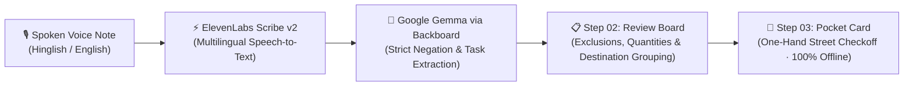

<div align="center">

# 🚶 Nikalll (WalkRecall)
### *Turn chaotic doorstep voice notes into a structured, offline-ready errand card.*

[](https://nikalll.onrender.com/)
[](https://nextjs.org/)
[](https://ai.google.dev/gemma)
[](https://elevenlabs.io/)
[](https://www.typescriptlang.org/)

<p align="center">
  <strong>Speak once before leaving home, review in seconds, and walk out with a glanceable neighborhood checklist that works completely offline.</strong>
</p>

[Explore Live Demo](https://nikalll.onrender.com/) · [Architecture](#-architecture) · [Features](#-key-features) · [Quick Start](#-quick-start)

---

</div>

## 💡 The Problem: The "Doorstep Voice Note" Chaos

Every time you step out of the house, your mother, roommate, or partner shouts a rapid-fire, chaotic list of errands:

> *"Arre suno! Bahar ja rahe ho toh sabzi mandi se 1 kg aloo aur dhaniya le lena... par tamatar mat lana ghar pe already hain... phir kirana store se 2 litre doodh aur dahi le lena, par bread bilkul mat lana... aur chemist se BP syrup le lena, band-aid mat lana wo drawer me hai!"*

### Why traditional tools fail:
1. **To-Do Apps are too slow:** No one has the time or patience to manually type 8 separate items with quantities while walking down the stairs.
2. **Audio Notes are useless on the street:** Listening to a 2-minute voice note over traffic noise while standing in a crowded grocery store is frustrating and stressful.
3. **Generic AI hallucinates & ignores cancellations:** Standard language models often see *"don't buy bread"* and foolishly add *"Bread"* to your shopping list, wasting money on duplicate items.

---

## ⚡ The Solution: Nikalll

**Nikalll** bridges the gap between chaotic human speech and a reliable street companion. It is designed around one focused promise:

> **Turn messy spoken requests into a human-reviewed, destination-assigned, offline-ready pocket card.**



---

## 🌟 Key Features

### 1. 🎙️ Multilingual Voice-First Ingestion
- Powered by **ElevenLabs Scribe v2** for ultra-accurate speech recognition.
- Effortlessly transcribes real-world code-switching (Hinglish, rapid pauses, conversational filler).
- Zero setup needed: just tap the microphone and speak naturally.

### 2. 🧠 Intelligent Negation & Cancellation Engine
- Driven by **Google Gemma (gemma-4-31b-it)** through **Backboard**.
- Explicitly isolates negative intent (*"don't buy"*, *"skip"*, *"fridge has plenty"*, *"cancel"*).
- Separates cancelled items into an **Excluded Items Ledger** with clear reasons, ensuring you never buy duplicates or unwanted goods.

### 3. 🏪 Neighborhood Destination Grouping
- Automatically organizes errands into realistic walk stops:
  - 🥬 **Fresh Market / Sabzi Mandi** (Produce, greens, seasonal items)
  - 🥛 **Local Grocery / Kirana** (Dairy, staples, packaged goods)
  - 💊 **Chemist / Pharmacy** (Prescriptions, wellness, first-aid)
  - 📦 **Post & Parcels** (Drop-offs, pickups)
  - ✏️ **Stationery & Supplies** (Notebooks, copies, pens)
- One-tap destination chips allow instant human overrides.

### 4. 📱 The Pocket Card (Designed for the Street)
- **One-handed UX:** Large tap targets and glanceable typography built for mobile screens while walking.
- **100% Offline-Ready:** Stores your state in local browser storage. Works flawlessly in grocery store basements with zero mobile reception.
- **Real-Time Walk Tracker:** Tap items to mark them complete with visual progress indicators.

### 5. 🔒 Privacy-First & Fail-Closed Boundaries
- **No creepy tracking:** No forced accounts, no GPS tracking, no remote data hoarding.
- **Runtime Zod Validation:** All LLM outputs pass strict schema parsing before touching the UI.
- **Graceful Fallbacks:** If external AI services are unavailable, manual entry and local splitting remain 100% functional.

---

## 🛠️ Tech Stack & Architecture

| Layer | Technology | Purpose |
|---|---|---|
| **Frontend** | **Next.js 16.4 (App Router)** | High-performance React server components & Turbopack build |
| **Styling & UI** | **Tailwind CSS v4 + Base UI** | Sleek, tactile, accessible design system (`base-sera`) |
| **Icons** | **Hugeicons React** | Crisp, lightweight iconography |
| **Voice AI** | **ElevenLabs Scribe v2** | High-precision multilingual audio transcription |
| **LLM Inference** | **Google Gemma (via Backboard)** | Deterministic errand extraction, quantity parsing & negation logic |
| **Validation** | **Zod v4** | Strict contract enforcement on all inputs and outputs |
| **Hosting** | **Render** | Production edge-hosted deployment with SSL proxy validation |

---

## 🧪 Interactive Walkthrough: Step-by-Step

### Step 01: Capture
Speak into the mic or paste a messy transcript:
> *"Bahar ja rahe ho toh Sharma Medical se mummy ka syrup le aana, band-aid mat lena wo rakhi hai. Kirana se 2 litre doodh aur dahi le lena par bread bilkul mat lana. Aur stationery se 3 notebook le aana."*

### Step 02: Review & Assign
- **Google Gemma** extracts:
  - `Syrup` (Chemist)
  - `2 litre milk` (Local Grocery)
  - `Dahi` (Local Grocery)
  - `3 notebooks` (Stationery)
- **Excluded Items:**
  - `Band-aid` (Reason: Already at home)
  - `Bread` (Reason: Explicitly cancelled)

### Step 03: The Pocket Card
- Tap **"Create Pocket Card"** to generate an offline, glanceable errand ticket.
- Tap off items one by one as you walk through your neighbourhood.

---

## 🚀 Quick Start (Run Locally)

### 1. Clone the repository
```bash
git clone https://github.com/taqui-786/nikalll.git
cd nikalll
```

### 2. Install dependencies
```bash
pnpm install
# or: npm install
```

### 3. Configure environment variables
Create a `.env` file in the root directory:

```env
# ElevenLabs Speech-to-Text
ELEVENLABS_API_KEY="your-elevenlabs-api-key"
ELEVENLABS_STT_MODEL_ID="scribe_v2"

# Google Gemma via Backboard
BACKBOARD_API_KEY="your-backboard-api-key"
GEMMA_PROVIDER="openrouter"
GEMMA_MODEL="google/gemma-4-31b-it"

# Optional: Maximum allowed audio upload in bytes (default: 8MB)
NIKAL_MAX_AUDIO_BYTES="8388608"
```

### 4. Run the development server
```bash
pnpm dev
```
Open [http://localhost:3000](http://localhost:3000) in your browser.

### 5. Run tests & type checks
```bash
npm test       # Domain model & provider normalization tests
npm run lint   # ESLint checks
npx tsc --noEmit # TypeScript strict mode verification
```

---

## 🎯 Hackathon Judging Criteria Alignment

- **Innovation & Originality:** Solves the real-world *"doorstep errand dump"* problem instead of building yet another generic to-do list.
- **AI Sophistication:** Leverages **Google Gemma** specifically for what SLMs/LLMs excel at: complex linguistic nuance, code-switching, and critical negation detection (*"don't buy X"*).
- **Voice UX:** Utilizes **ElevenLabs Scribe v2** for natural spoken capture without robotic form fields.
- **Practical Utility:** Designed from day one for offline street reality—no network dependency once the card is generated.
- **Software Craftsmanship:** Strict TypeScript, Zod schema validation, 100% test pass rate, and zero-bloat architecture.

---

<div align="center">

**Nikalll — Speak once. Review in seconds. Walk with confidence.**

Built with ❤️ for the Hackathon.

</div>
